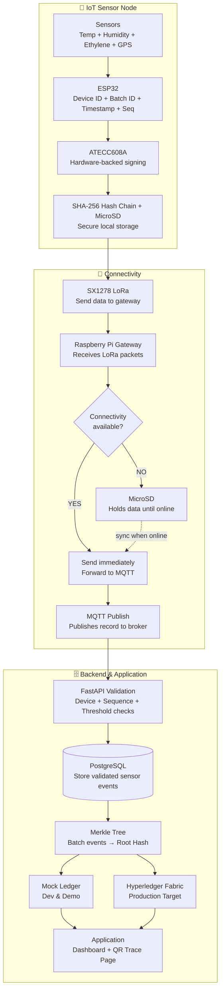

<div align="center">

# 🌾 FarmTrace
### Low-Cost IoT Blockchain Nodes for Farm-to-Fork Traceability

**Secure supply-chain data from farm to fork — even when connectivity fails.**

[]()
[]()
[]()
[]()
[]()
[]()

[Problem](#-problem) •
[Solution](#-our-solution) •
[Architecture](#-system-architecture) •
[Tech Stack](#-tech-stack) •
[Hardware](#-hardware-components) •
[Software Features](#-software-features--application-pages) •
[Workflow](#-detailed-workflow-step-by-step) •
[Getting Started](#-getting-started) •
[Roadmap](#-roadmap) •
[Team](#-team)

</div>

---

> **Architecture status:** This README describes the target FarmTrace architecture from the team's Smart India Hackathon 2026 design and identifies the current implementation status of each component. The repository currently contains an earlier Node.js/Express prototype with JSON storage, Wi-Fi/MQTT transport, browser pages, and an ESP32 DHT22/analog-gas firmware path; the LoRa, FastAPI, PostgreSQL, React, secure-element, and ledger components below remain target or validation work unless explicitly marked otherwise.

## 📖 Overview

**FarmTrace** is a low-cost, rugged, and energy-efficient IoT sensor node that continuously monitors **temperature, humidity, and ethylene gas** during agricultural transit. It combines **offline-first local storage**, **cryptographic data integrity**, and **blockchain anchoring** to keep supply-chain records trustworthy — even when the network isn't.

Built for **Smart India Hackathon 2026** — Problem Statement **#26232**.

## 🧩 Problem

Food supply chains today suffer from three compounding issues:

- **Connectivity gaps** — conventional data loggers lose records during network outages, especially on remote agricultural and transit routes.
- **Blind spots in spoilage detection** — most systems track only temperature and humidity, missing **ethylene**, the gas that signals ripening and spoilage.
- **Cost barriers** — commercial-grade cold-chain monitoring and traceability platforms are priced for large enterprises, leaving SMEs and rural supply chains without affordable options.

The result: food fraud, undetected spoilage, and traceability records nobody can fully trust.

## Implementation Status

The architecture below is the intended FarmTrace system. This table separates design targets from evidence present in the current repository; an architecture diagram alone is not treated as proof of implementation.

| Component | Status | Evidence / notes |
|---|---|---|
| ESP32 firmware | Partial prototype | `esp32/sensor_node.ino` contains DHT22, analog gas input, SD buffering, Wi-Fi, and MQTT code; it is not board-validated here. |
| SHT31 | Planned / requires validation | The target hardware is documented, but the repository firmware uses DHT22 instead. |
| Ethylene sensor | Prototype placeholder / requires calibration | Current firmware applies a placeholder conversion to an analog gas signal; it is not a calibrated ethylene concentration measurement. |
| GPS / NEO-6M | Planned / requires implementation | No GPS firmware or location data path is present. |
| ATECC608A | Planned / requires implementation | No secure-element integration is present. |
| MicroSD | Partial prototype | The ESP32 sketch includes an SD-backed queue; hardware operation is unvalidated. |
| DS3231 RTC | Planned / requires implementation | The current firmware uses software timestamps and does not integrate a DS3231. |
| SX1278 LoRa | Planned / requires implementation | No LoRa driver or gateway path is present. |
| Raspberry Pi gateway | Planned / requires implementation | No Raspberry Pi gateway service is present. |
| SQLite gateway queue | Planned / requires implementation | Current offline behavior is browser localStorage and an ESP32 SD queue, not a gateway SQLite queue. |
| MQTT over TLS | Not implemented | The prototype uses a local Aedes MQTT broker and non-TLS MQTT transport. |
| FastAPI | Planned / requires implementation | The current backend is Node.js/Express. |
| PostgreSQL | Planned / requires implementation | The current prototype persists to local JSON files. |
| Merkle service | Planned / requires implementation | The prototype has a SHA-256 hash chain but no Merkle batching service. |
| Mock ledger | Planned / requires implementation | No mock ledger service is present in the repository. |
| Hyperledger Fabric | Production target | No Fabric network or integration is present. |
| React dashboard | Planned / requires implementation | The current frontend is static HTML, CSS, and browser JavaScript. |
| QR traceability | Prototype implemented | The current Node.js prototype generates QR codes and exposes customer-safe traceability data. |
| Role-based access | Prototype implemented | Current Express routes enforce demo roles for Farmer, Transporter, Warehouse, Retailer, and Admin, with public customer views. |

The target design is therefore **proposed architecture**, the checked-in software is a **prototype/demo**, and physical hardware, field measurements, production security, and ledger deployment **require validation**.

## 💡 Our Solution

An **ESP32-based IoT node** captures temperature, humidity, and ethylene readings, each tagged with a timestamp, device ID, and batch ID. Key design decisions:

- **Offline-first buffering** — readings are persisted locally during network dropouts and automatically synced afterward over **MQTT over TLS**.
- **Cryptographic integrity at the edge** — a hardware secure element signs every record, and a SHA-256 hash chain makes tampering evident before data ever leaves the device.
- **Blockchain anchoring** — batches of validated records are rolled into a Merkle root and anchored on a permissioned ledger, so records are independently verifiable without putting every reading on-chain.
- **Rugged, low-power hardware** — an IP65 enclosure protects the node from moisture, dust, and vibration; a rechargeable battery powers the prototype, with solar/thermal energy harvesting planned for field deployment.

### ✨ Innovation

| | |
|---|---|
| 🌱 **Beyond temp & humidity** | Adds ethylene monitoring for spoilage-risk visibility conventional loggers miss |
| 📴 **Offline-first architecture** | Store-and-forward design prevents data loss during connectivity interruptions |
| 🔐 **Tamper-evident by design** | SHA-256 hash chaining + blockchain anchoring make records independently verifiable |
| 🔋 **Self-sustaining potential** | Energy harvesting + ruggedized enclosure for harsh field environments |
| 💰 **Built for SMEs** | Low-cost, modular hardware designed for smaller supply chains, not just enterprise budgets |

## Data Integrity and Security Model

The target design separates device identity, confidentiality, integrity, and external anchoring. None of these controls proves that a sensor was physically accurate; they make the recorded history integrity-verifiable and expose later changes.

### Device Identity and Signing

ATECC608A is intended to keep a device key in hardware and produce signatures without exposing the private key to the ESP32 application. The secure element should be used for device identity and signing according to its validated integration. It should not be described as encrypting the payload unless that exact operation is implemented and tested.

### Hash Chain

Each event references the previous event hash and is canonically serialized before hashing:

```text
Event N:
device_id
batch_id
timestamp
sequence
sensor_data
previous_hash
signature

hash_N = SHA256(canonical_event_N)
```

Changing or removing an event can break the expected chain relationship. The chain is tamper-evident, not tamper-proof; verification must report which record or link no longer matches.

### Encryption

Encryption protects confidentiality. Signing and hash chaining provide identity and integrity evidence; they are separate operations. The target design should document where event encryption occurs, how keys are provisioned, and how the gateway and backend decrypt or verify data. The current prototype uses AES-256-GCM at the Node.js service layer, not ATECC608A.

### Merkle Tree and Blockchain Anchor

Validated events are grouped into a defined Merkle batch. The batch identifier, event range or ordered event IDs, creation time, and resulting root identify what the root covers. The Merkle root, not every sensor reading, is anchored to the Mock ledger in development or Hyperledger Fabric in the production target. Blockchain anchoring provides an external integrity reference; it does not prove that the original sensor measurement was physically accurate.

An authorized verifier can retrieve an event, recompute its hash, validate its hash-chain relationship, generate or verify the relevant Merkle proof, and compare the resulting root with the anchored ledger record. Temporary anchoring failure should leave the validated batch in a retryable pending state rather than discard the events.

## 🏗 System Architecture

The pipeline runs in three stages — **sensor node → connectivity/gateway → backend & application** — designed so a connectivity dropout never means a data loss.



## 🛠 Tech Stack

| Layer | Technology |
|---|---|
| Controller | ESP32 DevKit |
| Temp/humidity sensor | SHT31 |
| Ethylene sensor | MQ-3 / TGS2620 |
| GPS | NEO-6M |
| Edge security | ATECC608A (hardware-backed signing) + SHA-256 hash chaining |
| Local storage | MicroSD + DS3231 RTC |
| Long-range comms | SX1278 LoRa → Raspberry Pi gateway |
| Sync protocol | MQTT over TLS |
| Backend framework | FastAPI (Python) |
| Database | PostgreSQL |
| Ledger | Hyperledger Fabric (production target) / Mock ledger (dev & demo) |
| Frontend | React dashboard + QR-based traceability page |

> Every row above describes the target architecture presented in the team's pitch deck (slide 3). No Node.js/Express backend, no computer-vision/TensorFlow Lite pipeline, and no soil-moisture/camera sensors are part of this target design; the current repository still contains the earlier Node.js/Express prototype and its DHT22/analog-gas firmware path, as recorded in the implementation status table.

## 🔩 Hardware Components

| Component | Role |
|---|---|
| ESP32 DevKit | Main controller — sensing, processing, and data logging |
| SHT31 | Temperature and humidity sensing |
| MQ-3 / TGS2620 | Ethylene gas indication (spoilage/ripening risk) |
| NEO-6M GPS | Location tagging along the transit route |
| ATECC608A | Hardware-backed device identity and cryptographic signing |
| MicroSD + DS3231 RTC | Offline data storage with accurate, tamper-resistant timestamps |
| SX1278 LoRa | Long-range, low-power communication to the gateway |
| Rechargeable battery | Prototype power supply (solar/thermal harvesting planned) |
| IP65 enclosure | Protection against moisture, dust, and vibration |

**Sensor limitations:** MQ-3, TGS2620, and similar gas sensors can have cross-sensitivity to other gases and environmental conditions. The selected device requires calibration against a reference instrument before its output can be reported as an ethylene concentration. Until then, the software should label it an **ethylene-related gas response / spoilage-risk indicator**, retain the raw response and calibration metadata, and avoid laboratory-grade accuracy claims.

**GPS limitations:** NEO-6M coordinates are attached only to events with a valid fix. Indoor operation, poor satellite visibility, and acquisition timeout must be represented explicitly as unavailable or invalid rather than replaced with fake coordinates. Sampling frequency should be configurable, and GPS accuracy should be measured in the deployment rather than assumed.

## Preliminary Hardware Cost

Prices are intentionally left open until suppliers, quantities, and the final board revisions are selected.

| Component | Qty | Estimated cost | Status |
|---|---:|---|---|
| ESP32 | 1 | TBD | Prototype |
| SHT31 | 1 | TBD | Prototype / validation |
| Selected gas sensor | 1 | TBD | Validation |
| NEO-6M GPS | 1 | TBD | Prototype |
| ATECC608A | 1 | TBD | Prototype / planned integration |
| MicroSD module/card | 1 | TBD | Prototype |
| DS3231 RTC | 1 | TBD | Prototype / planned integration |
| SX1278 LoRa module | 1 | TBD | Prototype / planned integration |
| Rechargeable battery | 1 | TBD | Prototype |
| IP65 enclosure | 1 | TBD | Prototype |
| Raspberry Pi gateway | 1 | TBD | Prototype / planned integration |
| **Total** |  | **To be calculated** |  |

## LoRa Communication Contract

The target SX1278 link should use compact packets containing the device ID, event ID, batch ID, sequence number, timestamp or RTC reference, sensor fields, previous hash reference, signature or signature reference, and a protocol version. Payload size must be kept within the selected LoRa configuration; large records should be fragmented only after a tested packet and reassembly design exists.

The gateway should acknowledge accepted packets. A missing acknowledgment triggers bounded retry and local retention. The event ID and/or the device ID plus sequence number provide duplicate detection when retries reach the gateway more than once. Expected range depends on antenna, spreading factor, environment, and deployment conditions; field testing is required.

## 💻 Software Features & Application Pages

The application layer is a **React dashboard** and **QR traceability page**, backed by **FastAPI + PostgreSQL**, fed by the sensor node pipeline above. It's organized around **six roles**, matching the actual farm-to-fork handover chain — **Farmer → Transporter → Warehouse (Distributor) → Retailer → Customer (Consumer)**, plus a cross-cutting **Admin** role. Each role sees only the page(s) relevant to what they actually do in the flow.

### Farmer Page

**Purpose:** Register batches, pair field nodes to them, and monitor live cold-chain conditions from harvest onward.

**Key features:**
- Register a new product/batch (crop, variety, harvest date) and generate its batch ID.
- Pair an ESP32 field node to the batch via QR/BLE scan (plug-and-play — no manual firmware configuration in the field).
- View live temperature, humidity, ethylene, and GPS location from the paired node.
- View the node's connectivity status (online / buffering offline) and battery level.
- Log the **"Harvested"** handover event, starting the batch's traceability record.
- View alerts (ethylene spike, temperature excursion, device offline).

**How it works:** the farmer registers the batch (stored via FastAPI/PostgreSQL), pairs a node by scanning the batch QR, and from then on the node's readings — encrypted, signed by ATECC608A, hash-chained, and stored locally — reach the dashboard via LoRa → gateway → MQTT. Logging "Harvested" creates the batch's first traceability event.

### Transporter Page

**Purpose:** Maintain and hand off custody of a batch while it's in transit, with environmental proof of custody throughout.

**Key features:**
- View batches currently assigned for transport.
- Log the **"Dispatched"** and **"In Transit"** handover events.
- View live cold-chain conditions for the batch during the journey.
- See a clear indicator of whether the node is online or buffering offline — no data loss either way.
- Receive alerts if conditions breach a threshold mid-transit.

**How it works:** while in transit — including through connectivity dead zones — the node keeps sensing, hash-chaining, and storing locally; the gateway queues records in SQLite if offline and flushes them over MQTT the moment connectivity returns. The page always shows the latest reading the node has taken, synced or not.

### Warehouse (Distributor) Page

**Purpose:** Record intake at a storage/distribution point and verify the batch's condition history before accepting it.

**Key features:**
- Log the **"Received at Storage"** handover event.
- View the batch's full environmental history since harvest, not just the current reading.
- View the integrity status of the batch's record (hash chain intact / anchored Merkle root verified).
- Flag and escalate a batch if its history shows a threshold breach.

**How it works:** on arrival, the operator scans the batch QR; the backend recomputes the hash chain and compares it against the last Merkle root anchored to the ledger, surfacing any mismatch immediately rather than accepting it silently.

### Retailer Page

**Purpose:** Record final intake before sale and give retail staff an at-a-glance trust signal for the batch.

**Key features:**
- Log the **"Received at Retail"** handover event.
- View the complete farm-to-retail journey and environmental summary in one place.
- View the same integrity-verified / broken indicator as the Warehouse page.

**How it works:** the retailer scans the batch QR on delivery and sees the full traceability record — every handover from "Harvested" onward, plus an environmental summary — before logging "Received at Retail," at which point the batch's consumer-facing QR goes live.

### Customer (Consumer) Traceability Page

**Purpose:** Give the end consumer a simple, read-only way to verify where their food came from and how it was handled.

**Key features:**
- Scan the product's QR code — no login or app required.
- View product name, origin farm, and harvest date.
- View the full journey: Farm → Transporter → Warehouse → Retailer → Consumer.
- View a plain-language environmental summary.
- View an "Integrity verified" badge confirming the hash chain and anchored ledger record match.

**How it works:** the customer-facing service resolves the batch ID and returns its public traceability summary — no private device credentials, raw sensor logs, or keys are exposed — with an integrity status computed from the same hash-chain and Merkle-root check used internally.

### Admin Page

**Purpose:** Give operators system-wide visibility and control across devices, batches, ledger status, and alerts.

**Key features:**
- Register and monitor all ESP32 field nodes (device ID, last-seen time, connectivity status, battery level).
- View and manage all batches across every stage of the supply chain.
- View ledger/anchoring status — Mock ledger (dev/demo) or Hyperledger Fabric (production) — and the history of anchored Merkle roots.
- Configure alert thresholds per crop/sensor rather than one-size-fits-all.
- Manage operator accounts and role-based access.
- Review system health: backend, database, and gateway connectivity.

**How it works:** FastAPI verifies the admin's identity and role permissions, then the dashboard queries device, batch, alert, and ledger status directly from PostgreSQL and the Blockchain Interface; configuration changes are validated and recorded for auditing.

### Shared Capabilities Across Role Pages

These aren't separate pages — they're views that appear inside the role pages above, using the same underlying data:

| Capability | Where it appears | What it shows |
|---|---|---|
| **Sensor monitoring** | Farmer, Transporter, Warehouse, Retailer | Temperature, humidity, ethylene, and GPS history for a batch, with timestamps and device ID |
| **Alerts** | All roles (role-filtered) | Threshold breaches, device-offline warnings, sync failures |
| **Offline / sync status** | Farmer, Transporter, Admin | Whether the node/gateway is online, buffering, or syncing — and how many records are queued |
| **Integrity status** | Warehouse, Retailer, Customer, Admin | Hash-chain verified / broken, and the last anchored Merkle root reference |

### Permission Matrix

Role-based access control is an application-level backend requirement. Hiding a page or button in React is not sufficient authorization.

| Role | Register batch | Monitor telemetry | Record handover | View integrity | Administer system |
|---|---:|---:|---|---|---:|
| Farmer | Yes | Yes | Harvested | View | No |
| Transporter | No | Yes | Dispatched / In Transit | View | No |
| Warehouse / Distributor | No | Yes | Received at Storage | Verify | No |
| Retailer | No | Yes | Received at Retail | Verify | No |
| Customer | No | Public summary only | No | Public verification status | No |
| Admin | Controlled | Controlled | Controlled | Yes | Yes |

The exact permission rules should be enforced by FastAPI or the deployed backend against the authenticated role and batch assignment. The current prototype enforces a smaller demo policy in Express routes.

### Handover State Validation

The target batch state machine remains simple and ordered:

```text
Harvested
   ↓
Dispatched
   ↓
In Transit
   ↓
Received at Storage
   ↓
Received at Retail
   ↓
Customer
```

Each handover records the actor or role, timestamp, batch ID, location when available, previous state, new state, and event ID. The backend must reject impossible transitions such as `Retail -> Harvested` or `Customer -> Dispatched`, and must make a repeated event idempotent rather than appending it twice.

### Customer QR Privacy

The QR page is read-only and should expose only the permitted public summary: product, origin, harvest date, supply-chain stages, environmental summary, and integrity status. It must not expose private credentials, cryptographic private keys, internal device secrets, sensitive infrastructure details, or private security metadata.

## Offline-First Buffering

The target architecture has two distinct buffering levels:

### Node-Level Buffering

```text
Sensor event
    ↓
Hash/sign
    ↓
MicroSD
    ↓
Retry transmission over LoRa
```

If the ESP32 cannot reach the gateway, it keeps the signed event locally and retries later. The node must not delete the record before an acknowledgment tied to its event ID is received.

### Gateway-Level Buffering

```text
LoRa packet
    ↓
Raspberry Pi
    ↓
SQLite queue
    ↓
Retry
    ↓
MQTT
```

| Failure | Buffer | Recovery behavior |
|---|---|---|
| ESP32 -> gateway unavailable | MicroSD | Retry later after a gateway acknowledgment path is available. |
| Gateway -> backend unavailable | SQLite queue | Flush after reconnect while preserving event identity. |
| MQTT unavailable | Gateway queue | Retry delivery; do not discard the event. |
| Backend receives duplicate | Database idempotency check | Ignore or acknowledge the duplicate without creating a second event. |
| Records arrive out of order | Sequence number and previous-hash reference | Detect and reconcile; do not silently reorder an invalid chain. |
| Storage nearly full | Node/gateway capacity monitor | Alert the operator and apply a documented retention policy. |

The current repository demonstrates an ESP32 SD queue and a browser localStorage queue, but not the target LoRa gateway or SQLite queue.

## Event Identity and Target Contract

Each target event should have an explicit unique identity. A proposed contract is:

```json
{
  "event_id": "esp32-node-01-000042",
  "device_id": "esp32-node-01",
  "batch_id": "MANGO-BATCH-001",
  "sequence_number": 42,
  "timestamp": "2026-09-30T10:00:00Z",
  "temperature": 8.2,
  "humidity": 78,
  "ethylene": 1.1,
  "latitude": 12.52,
  "longitude": 76.89,
  "previous_hash": "...",
  "record_hash": "...",
  "signature": "..."
}
```

`event_id`, or the device ID plus sequence number, is used for idempotent ingestion. Latitude and longitude are optional and must be absent or explicitly invalid when no GPS fix exists. This is a target event contract; the current prototype uses `event_id`, device/batch identifiers, `temp`, `hum`, and `eth`.

## 🔄 Detailed Workflow, Step by Step

| Step | Component | Operation | Output |
|---|---|---|---|
| 1 | ESP32 | Starts firmware and initializes SHT31, MQ-3/TGS2620 ethylene sensor, NEO-6M GPS, and ATECC608A. | Ready field node |
| 2 | SHT31 + MQ-3/TGS2620 + NEO-6M | Measure temperature, humidity, ethylene, and location. | Raw sensor readings |
| 3 | ESP32 firmware | Tags the reading with device ID, batch ID, timestamp, and sequence number. | Sensor event |
| 4 | ATECC608A | Signs the record with a key intended to remain in the secure element; payload confidentiality is handled by the separately specified encryption layer. | Signed event |
| 5 | ESP32 firmware | Computes a SHA-256 hash over the canonical event and chains it to the previous record's hash. | Hash-chained event |
| 6 | MicroSD + DS3231 RTC | Writes the record locally with a retained timestamp and queue metadata. | Durable local copy |
| 7 | SX1278 LoRa | Transmits the record to the Raspberry Pi gateway. | Radio packet |
| 8 | Raspberry Pi gateway | Checks whether backend connectivity is currently available. | Connectivity decision |
| 9a | MQTT client (if online) | Publishes the record to the broker immediately. | Published message |
| 9b | SQLite offline queue (if offline) | Buffers the record locally until connectivity returns. | Queued record |
| 10 | Gateway (on reconnect) | Flushes the queue oldest-first over MQTT, preserving original order. | Synchronized records |
| 11 | FastAPI | Validates device identity, sequence continuity, hash-chain integrity, and threshold rules. | Accepted or rejected event |
| 12 | PostgreSQL | Stores the validated sensor event. | Stored record |
| 13 | Merkle service | Batches stored events and computes a Merkle root for the batch. | Batch root hash |
| 14 | Blockchain interface | Anchors the root hash to the Mock ledger (demo) or Hyperledger Fabric (production). | Anchored batch reference |
| 15 | Alert service | Evaluates ethylene/temperature/humidity thresholds and device last-seen time. | Alert event |
| 16 | Farmer / Transporter / Warehouse / Retailer | Records a handover event at their stage of custody. | Handover event |
| 17 | Traceability service | Appends the handover event to the batch's append-only journey. | Updated traceability record |
| 18 | QR service | Generates or resolves the batch's QR code. | QR code / trace link |
| 19 | Customer page | Displays the batch's journey, environmental summary, and integrity status to anyone who scans the QR. | Traceability page view |
| 20 | Admin dashboard | Displays device status, ledger anchoring history, alerts, and role management. | Admin view |
| 21 | React dashboard | Displays live telemetry, alerts, and batch status to Farmer/Transporter/Warehouse/Retailer. | Live dashboard view |
| 22 | Integrity check (any role) | Recomputes the hash chain and compares it against the anchored Merkle root; flags any mismatch immediately. | Verified / broken status |

### Software Architecture Summary

| Software module | Main responsibility | Dependency |
|---|---|---|
| Farmer page | Batch registration, node pairing, live telemetry, "Harvested" handover | ESP32 node, FastAPI, PostgreSQL |
| Transporter page | "Dispatched"/"In Transit" handovers, live telemetry during transit | LoRa, gateway offline queue, MQTT |
| Warehouse page | "Received at Storage" handover, batch history, integrity check | FastAPI, PostgreSQL, Merkle/ledger |
| Retailer page | "Received at Retail" handover, full journey view, integrity check | FastAPI, PostgreSQL, Merkle/ledger |
| Customer page | Public QR-based traceability and integrity badge | QR service, customer-facing API |
| Admin page | Device, batch, ledger, alert, and role management | FastAPI, PostgreSQL, Blockchain Interface |
| Sensor monitoring | Environmental history and charts per batch/device | PostgreSQL |
| Alerts | Threshold and connectivity alerting | Alert service |
| Offline/sync status | Queue depth and sync state visibility | Gateway SQLite queue, MQTT |
| Integrity status | Hash-chain verification, Merkle root comparison | SHA-256 hash chain, Blockchain Interface |

> The modules above describe the target FarmTrace architecture. The current repository is a separate Node.js/Express demonstration and does not yet provide the FastAPI, PostgreSQL, React, LoRa gateway, secure-element, or Merkle/Fabric implementations described here.

## Merkle and Ledger Verification

The target integrity path is:

```text
Sensor events
    ↓
PostgreSQL
    ↓
Merkle tree
    ↓
Merkle root
    ↓
Mock ledger / Hyperledger Fabric
```

A Merkle batch should have a stable batch ID, ordered event IDs or sequence range, creation timestamp, and anchored root reference. A verifier uses the event ID and batch metadata to identify the root that covers the event. If anchoring temporarily fails, the root remains pending and is retried; validated events are not silently discarded. Anchoring establishes an external integrity reference after storage, but it cannot establish that the original sensor reading was truthful or physically accurate.

## ✅ Feasibility & Challenges

<table>
<tr><th>Challenges</th><th>Our Strategy</th></tr>
<tr><td>Remote/variable connectivity</td><td>LoRa + offline storage buffers data and auto-syncs on reconnect</td></tr>
<tr><td>Ethylene sensor calibration</td><td>Field validation against reference measurements</td></tr>
<tr><td>Power management over long duration</td><td>Low-power operation, sleep modes, and planned energy harvesting</td></tr>
<tr><td>Harsh environments (moisture, dust, vibration)</td><td>Rugged IP65 enclosure</td></tr>
<tr><td>Data volume at scale</td><td>Full records kept off-chain; only batch Merkle roots anchored on-chain</td></tr>
</table>

**Commercial feasibility:** SME-friendly hardware cost, one Raspberry Pi gateway can serve multiple sensor nodes, reduced maintenance through local buffering, and clear traceability value for farmers, logistics operators, retailers, and auditors.

## Prototype Validation Plan

The following acceptance tests are planned for the target hardware and services. They must not be reported as successful until evidence is collected.

| Area | Measurement or test | Acceptance evidence |
|---|---|---|
| Sensor | Compare temperature and humidity with a reference device; calibrate the gas sensor against a reference instrument. | Calibration record, error range, and raw-versus-calibrated data. |
| Offline recovery | Disconnect the network, generate events, restore connectivity, and replay the queues. | No lost events, no duplicate events, and preserved event identities. |
| LoRa | Exercise node-to-gateway communication under representative conditions. | Packet success rate, retry behavior, and tested deployment conditions. |
| Security | Modify a stored event or chain link. | Hash-chain verification identifies the modification. |
| Merkle verification | Alter an event after anchoring. | Merkle proof or root comparison fails as expected. |
| Gateway recovery | Restart the Raspberry Pi while records are queued. | SQLite queue survives restart and drains after reconnect. |
| Backend idempotency | Submit the same event more than once and submit a changed payload with the same identity. | Duplicate is acknowledged; conflicting payload is rejected. |
| Power | Run the assembled node under the intended sampling and transmission schedule. | Measured battery life and power profile; no assumed runtime. |

## Target Architecture Data Flow

```text
Batch Registration
    ↓
Node Pairing
    ↓
Sensor Measurement
    ↓
Event Creation
    ↓
Signing + Hash Chain
    ↓
Local Storage
    ↓
LoRa
    ↓
Raspberry Pi Gateway
    ↓
 ┌───────────────┐
 │ Backend online│
 └───────┬───────┘
     YES │ NO
       │
    MQTT │ SQLite Queue
       │
       └──────→ Retry
            ↓
           FastAPI
            ↓
          Validation
            ↓
          PostgreSQL
            ↓
          Merkle Tree
            ↓
         Ledger Anchor
            ↓
         Alerts + Dashboard
            ↓
         Handover Events
            ↓
             QR
            ↓
        Customer Traceability
```

The deployed implementation may process alerts, ledger anchoring, and dashboard updates asynchronously. The current repository does not implement this target flow end to end.

## 📊 Impact & Benefits

| Existing Monitoring Systems | FarmTrace |
|---|---|
| Cloud-dependent monitoring | Offline-first monitoring |
| Data loss during network failure | Local storage + auto-sync |
| Mainly temperature & humidity | Temperature + humidity + ethylene |
| Centralized data records | Cryptographic + blockchain integrity |
| Expensive deployment | Low-cost deployment |
| Limited traceability | Farm → Fork QR traceability |
| Frequent battery dependency | Energy-harvesting roadmap |

**Who benefits:**
- 🌾 **Farmers & SMEs** — affordable real-time monitoring without expensive commercial systems
- 🚚 **Transporters & logistics** — continuous environmental records, even through network interruptions
- 🏭 **Food processors & distributors** — batch-level tracking and early risk identification
- 🛒 **Retailers & consumers** — QR-based product history for transparent farm-to-fork traceability

## 🔍 Research & Competitive Landscape

**Existing solutions referenced:**
- **[IBM Food Trust](https://www.ibm.com/products/food-trust)** — permissioned blockchain-based food traceability and shared supply-chain records; relevant to FarmTrace's shared traceability and ledger-anchor target.
- **[TE-FOOD](https://te-food.com/)** — end-to-end food traceability on a permissioned blockchain; relevant to FarmTrace's batch and handover journey.
- **[Tive](https://tive.com/)** — real-time shipment monitoring for temperature, humidity, location, shock, and light; relevant as a commercial comparison for sensor logistics monitoring.

**Where FarmTrace differs:** existing IoT loggers typically track temperature, humidity, and location; FarmTrace adds **ethylene monitoring** for spoilage-risk visibility, and layers **ATECC608A + SHA-256 hash chaining** at the edge — before transmission — as an additional integrity layer most commercial systems don't provide at this price point.

**References:**
1. S. K. Singh, R. K. Lenka, S. R. Mallick, et al., *"An integrated IoT edge cloud and blockchain framework for a traceable, transparent and scalable digital millet supply chain,"* Scientific Reports, 2026.
2. A. Gupta and V. Jain, *"Blockchain-Assisted IoT Framework for Reliable Monitoring and Predictive Analytics in Perishable Food Supply Chains,"* Journal of Food Process Engineering, 2026.
3. FSSAI food safety and traceability regulations.
4. Government of India digital agriculture and blockchain-based traceability initiatives.

## 🚀 Getting Started

The target FarmTrace architecture and the current repository prototype have different setup requirements. The commands below run the checked-in prototype; the FastAPI/React/LoRa deployment remains planned.

### Repository Structure

```text
backend/
    server.js                 Node.js/Express server
    config/                   Runtime configuration
    data/                     Local products and sensor ledger
    routes/                   Auth, product, reading, and traceability routes
    services/                 Authorization, crypto, storage, ingestion, MQTT
    test/                     Node integration tests
esp32/
    sensor_node.ino           ESP32 DHT22/analog-gas/SD/MQTT path
frontend/
    index.html                Dashboard shell
    css/style.css             Dashboard styles
    js/                       Browser API and dashboard code
.env.example                Prototype environment template
package.json                Node.js scripts and dependencies
README.md
```

### Environment Configuration

The current prototype reads these values from `.env` through `dotenv`:

```text
PORT
MQTT_PORT
DEVICE_API_KEY
DEMO_AUTH_SECRET
DEMO_ROLE_PASSWORD_FARMER
DEMO_ROLE_PASSWORD_FARMER_SURESH
DEMO_ROLE_PASSWORD_TRANSPORTER
DEMO_ROLE_PASSWORD_WAREHOUSE
DEMO_ROLE_PASSWORD_RETAILER
DEMO_ROLE_PASSWORD_ADMIN
DEMO_FARMER_NAME
DEMO_FARMER_SECONDARY_NAME
DEMO_TRANSPORTER_NAME
DEMO_WAREHOUSE_NAME
DEMO_RETAILER_NAME
CLOUD_PROVIDER
AWS_ACCESS_KEY_ID       # only when CLOUD_PROVIDER=aws
AWS_SECRET_ACCESS_KEY   # only when CLOUD_PROVIDER=aws
AWS_REGION              # only when CLOUD_PROVIDER=aws
AWS_BUCKET              # only when CLOUD_PROVIDER=aws
```

Never commit `.env`, API keys, passwords, or cloud credentials.

### Prerequisites
- ESP32 toolchain (Arduino IDE or ESP-IDF)
- Node.js 18+ and npm for the checked-in prototype
- Optional ESP32 hardware and Arduino libraries for the firmware path

The planned target additionally requires Python 3.10+, PostgreSQL, a Raspberry Pi gateway, FastAPI, React tooling, LoRa hardware, and the selected secure-element and sensor libraries. Those components are not currently installed or represented by this repository.

### Firmware
```bash
# The current sketch is at esp32/sensor_node.ino.
# Open it in Arduino IDE after installing the ESP32 core and libraries
# listed in the sketch; configure credentials locally before flashing.
```

### Gateway & Backend
```bash
npm install
Copy-Item .env.example .env   # PowerShell; fill values locally
npm start                      # Node.js/Express prototype on port 3000
```

Open `http://localhost:3000`. The prototype starts a local Aedes MQTT broker on port `1883` by default. It does not start the proposed Raspberry Pi gateway, FastAPI service, PostgreSQL database, or MQTT-over-TLS deployment.

### Dashboard
```bash
# The dashboard is served by the prototype server at http://localhost:3000.
# There is no separate React frontend package in the current repository.
```

## Testing

The current repository has Node's built-in integration tests and JavaScript syntax checks:

```powershell
npm test
node --check frontend/js/dashboard.js
node --check frontend/js/api.js
```

The tests cover prototype traceability, role authorization, QR generation, sensor ingestion, duplicate/conflict handling, encryption, hash-chain verification, local replacement behavior, MQTT acknowledgments, and browser-queue synchronization. No evidence is present for firmware hardware tests, LoRa packet success rate, SQLite recovery, MQTT/TLS, FastAPI/PostgreSQL integration, React tests, ATECC608A signing, Merkle proofs, or Hyperledger Fabric. Those belong in the validation plan below.

## 🗺 Roadmap

- [ ] Complete ESP32 firmware integration for the selected SHT31, gas sensor, GPS, RTC, MicroSD, and ATECC608A components
- [ ] Complete SX1278 LoRa node-to-gateway integration
- [ ] Complete MQTT/TLS transport and Raspberry Pi SQLite queue recovery
- [ ] Implement the FastAPI and PostgreSQL backend
- [ ] Implement the React dashboard and six-role access control
- [ ] Implement batch state validation and idempotent handover events
- [ ] Validate offline recovery, hash-chain integrity, and Merkle proofs
- [ ] Solar / thermal energy harvesting for indefinite field operation
- [ ] Field calibration of the ethylene sensor against reference instruments
- [ ] Migration from mock ledger to production Hyperledger Fabric network
- [ ] Multi-node deployment behind a single shared gateway
- [ ] Expanded QR traceability page with full handover history (farm → transporter → distributor → retailer → consumer)
- [ ] Measure battery life and LoRa reliability/range under representative conditions
- [ ] Complete an end-to-end farm-to-fork demonstration

## 👥 Team — Gryffin_Coders

| Field | Detail |
|---|---|
| Team ID | 138997 |
| Problem Statement ID | 26232 |
| Theme | Agriculture, Food Tech & Rural Development |
| Category | Hardware |

## 🔗 Links

- **GitHub:** [farm-to-fork-traceability](https://github.com/DanielRaj-2005/farm-to-fork-traceability)
- **Demo video:** _add link once uploaded_

## 📄 License

This project is submitted for Smart India Hackathon 2026. The repository does not currently contain a `LICENSE` file, so the license is **to be finalized**. The MIT badge is intentionally marked `TBD` until the team adds and commits an authoritative license.

---

<div align="center">

*Affordable. Rugged. Tamper-proof. From farm to fork.*

</div>
